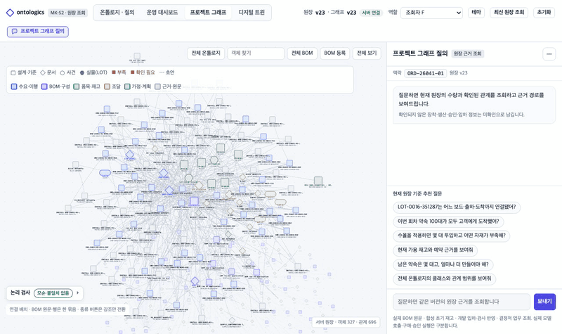
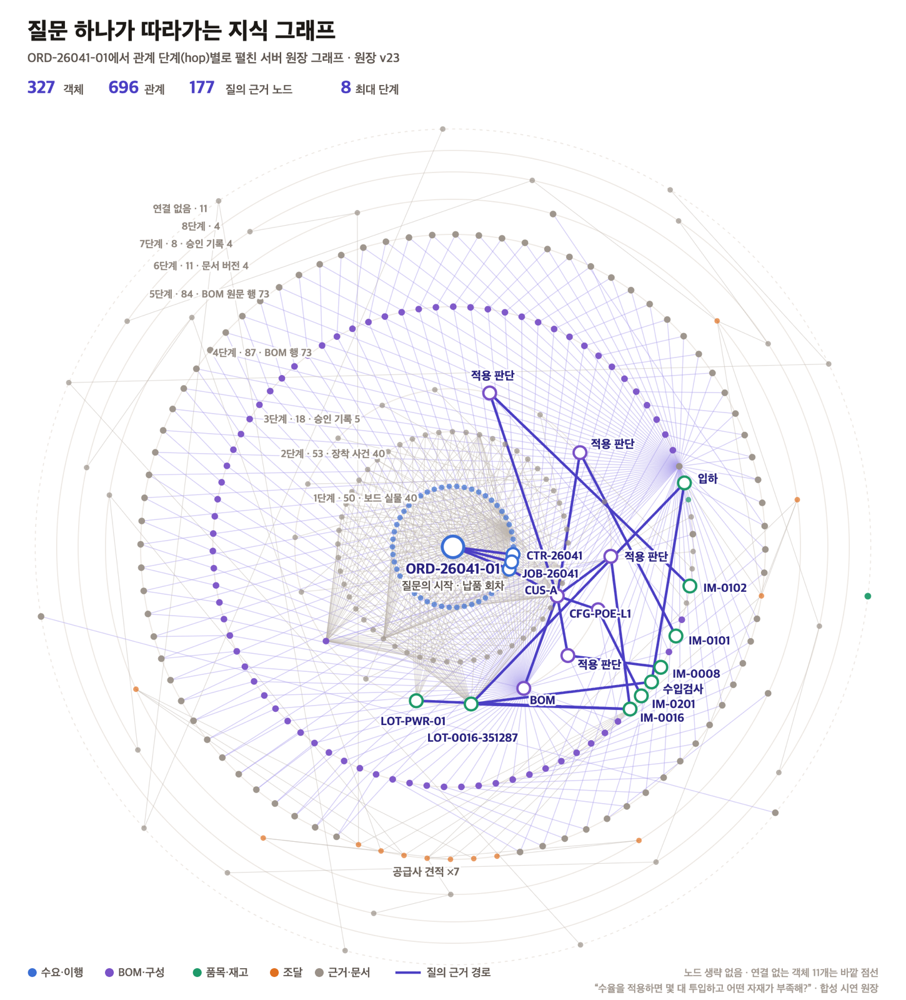
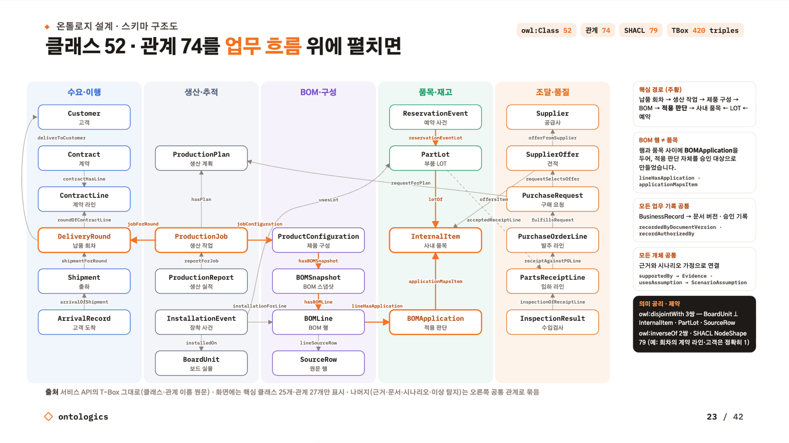
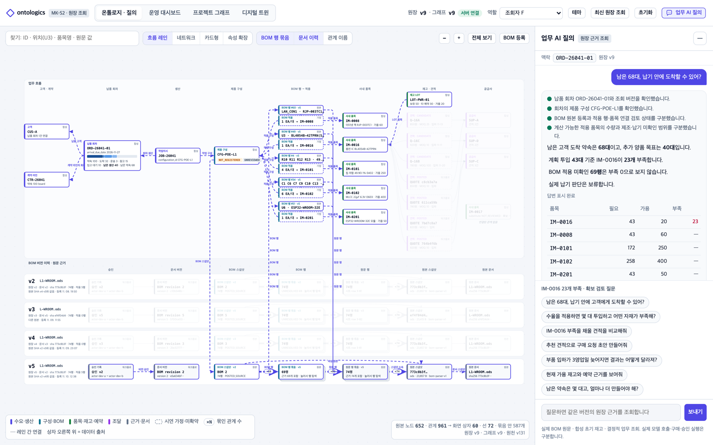
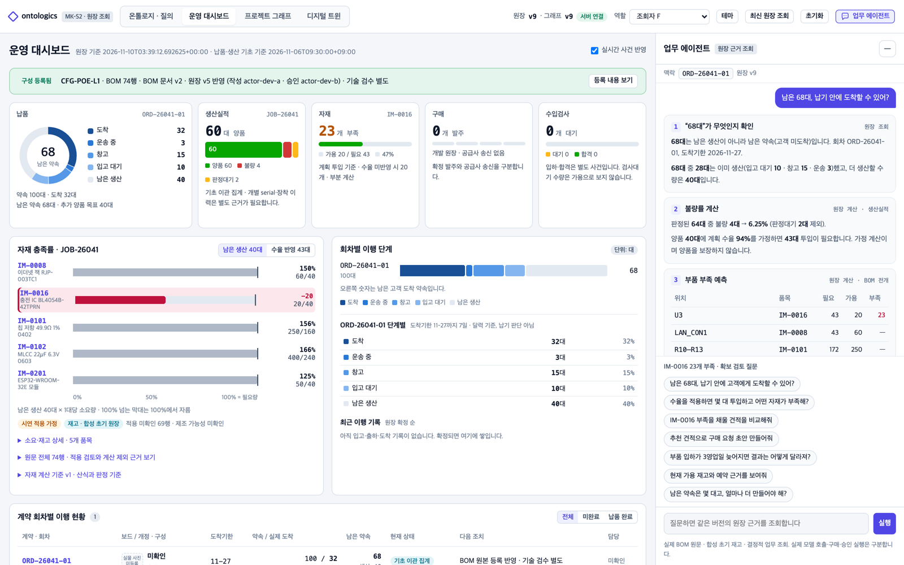
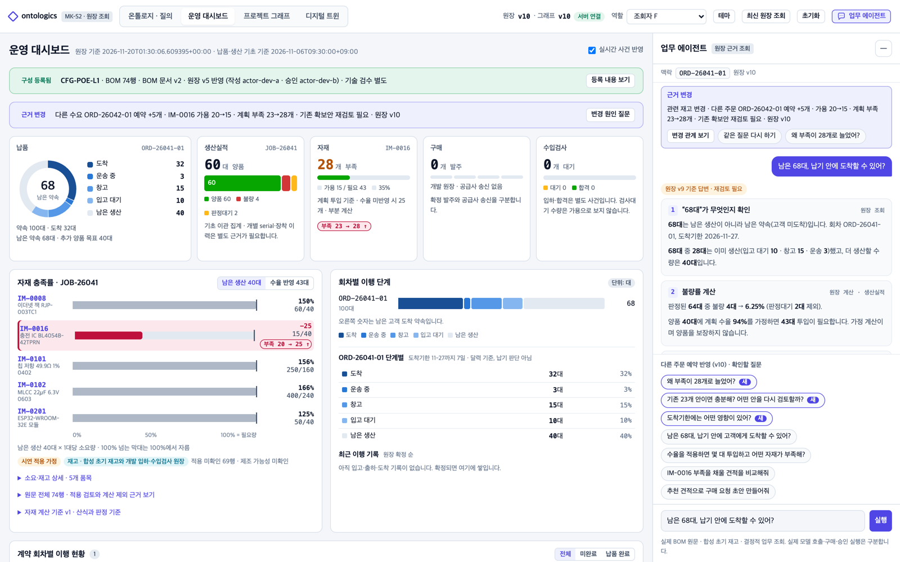

# ontologics-chat 개발 인계

> 코드 검토·평가는 [검토 안내](docs/REVIEW_GUIDE.md)부터 보세요. 무엇을 만들었는지, 어디부터 보면 되는지, 테스트 실행 방법과 한계를 정리했습니다.

## 프로젝트 개요 · 질문 하나가 따라가는 지식 그래프

"미납품 68대가 기한 안에 고객에게 도착할까?" 한 문장에 답하려면 영업·생산·BOM·재고·구매·검사·물류의 상태가 모두 필요하다. Ontologics는 흩어진 원장을 온톨로지로 이어, 숫자는 그래프 관계를 따라 서버가 계산하고 답마다 근거와 원장 버전을 붙인다. 근거가 없으면 판단을 보류하고 다음에 할 일을 안내한다.



*원장 v23, 프로젝트 그래프. "LOT-0016-351287는 어느 보드·출하·도착까지 연결됐어?"에 답하면서 근거 관계를 하나씩 확대해 그린다. 소비 30개 → 보드 30대 → 입고·출하·고객 도착 30대. 모델 호출 0회, 2배속.*



*격리 시연 원장 v23의 객체 327 · 관계 696을 생략 없이, 납품 회차 `ORD-26041-01`에서의 연결 단계(1~8)별 고리에 배치한 도식. 굵은 선은 "수율을 적용하면 몇 대 투입하고 어떤 자재가 부족해?"의 질의 근거 경로다. 화면 캡처가 아니라 서버 데이터로 다시 배치했다.*

| 항목 | 값 |
|---|---|
| T-Box | owl:Class 52 · 관계 74 · SHACL NodeShape 79 · 420 triples |
| 원본 BOM | 공개 하드웨어 BOM 74행 등록, 행 단위 출처 추적 (69행은 적용 미확인) |
| 원장 | PostgreSQL 확정 원장 → 원장 버전별 RDF Named Graph·Neo4j 투영, SHACL CONFORMS일 때만 READY |
| 시연 데이터 | 주문·생산·재고·조달은 합성 시연 원장 |

**설계 요점**
- **CQ로 범위를 정했다.** 중심 질문을 부서별 하위 질문으로 나누고, 그 질문에 쓰이지 않는 클래스는 만들지 않았다.
- **BOM 행과 사내 품목 사이에 `BOMApplication`을 두었다.** 행과 품목은 1:1이 아니므로 "이 행을 이 품목에 적용한다"는 판단 자체를 사람이 검토·승인하는 대상으로 만들었다.
- **OWL은 의미, SHACL은 제약.** Open World의 OWL로는 누락을 위반으로 볼 수 없어 필수값·개수·등식은 SHACL(-SPARQL)로 검사하고, OWL 2 RL 추론은 모순·유형 불일치 보고에만 쓴다.
- **수량은 서버가 계산한다.** 모델에는 허용 기능 플래그만 보내고, 미확인 매핑·단위·재고는 부족 0으로 보지 않는다.



**질문에서 근거 경로까지 (실제 서비스 화면)**



*원장 v9. 남은 약속 68대 · 추가 양품 40대 · 계획 투입 43대(수율 94% 가정) · IM-0016 부족 23개를 답하고, BOM 적용 미확인 69행과 실제 납기 판단은 보류로 남긴다. 왼쪽 흐름 레인에 같은 원장 버전의 근거 경로가 표시되며, 근거가 많은 BOM 행·원문 행은 묶음 상자로 접힌다.*

**사건이 생기면 관련 대화만 다시 알린다**




*다른 주문이 공용 부품 5개를 예약하는 원장 사건(v10)이 생기면, 그 질문을 했던 대화와 대시보드에만 "가용 20→15 · 계획 부족 23→28 · 기존 확보안 재검토 필요"가 표시되고 이전 답변에는 "원장 v9 기준 답변 · 재검토 필요"가 붙는다. 변경 감지와 재계산에는 모델을 부르지 않는다.*

**트러블슈팅에서 배운 것**

| 문제 | 원인 | 해결 | 결과 |
|---|---|---|---|
| SHACL을 통과하는 잘못된 그래프 | `rdfs:domain/range`는 잘못된 관계를 거부하지 않고 유형을 추가함 | OWL 2 RL로 선언과 다른 유형을 보고 | 모의 오류 탐지 6.3% → 99.2%, 실제 매핑 불일치 6건 발견 |
| 관계 질문 검색 실패 | 개체가 영어·코드 이름뿐, 규격 문자열이 한 토큰 | 한국어 이름표·규격 분해 색인 (관계 점수 RRF 합산은 되돌림) | Recall@10 0.73 → 0.94, 관계 0.33 → 1.00 (모델 변경 없음) |
| 숫자는 맞는데 결론이 과장 | 수량 검사는 "무엇까지 확인했나"를 보지 않음 | 원문 등록·적용 검토·납기 보류 분기 | 과장 1 → 0, 답변 품질 3.925 → 4.100 (토큰 비용 동일) |
| 근거가 많은 답변에서 그래프가 길게 늘어짐 | 근거 행을 하나씩 모두 펼쳐 고정 | 같은 묶음의 근거가 6개를 넘으면 접고 개수 표시 | 화면 상자 201 → 60 (노드·관계·답변 불변) |

탐지율·Recall·품질 점수는 자체 평가 세트(개발자가 만든 모의 오류 128건, 24사례, 블라인드 아닌 루브릭) 기준이다. 더 많은 화면: [LOT 실물 추적](docs/images/overview/07-lot-trace-real-graph.png) · [CQ 근거 경로 전체](docs/images/overview/06-cq-path-real-graph.png) · [답변 근거·버전 줄](docs/images/overview/qa_evidence.png) · [3D 디지털 트윈](docs/images/overview/08-digital-twin-3d.png) · [트러블슈팅 슬라이드](docs/images/overview/04-troubleshooting-owl-rl.png)

> 이 개요의 화면 캡처에는 공개 하드웨어 BOM의 행·부품 이름이 보인다. "실제 BOM은 공개 산출물에 넣지 않는다"는 기준의 예외로, 사용자 승인(DEC-H69)에 따라 `docs/images/overview/`의 캡처에 한해 공개한다. 원본 파일·fixture·평가 원문은 여전히 Git 밖에 둔다.

---

MK-S2의 화면·핵심 동선을 유지하면서 제조 업무를 실제 서버 원장·온톨로지·Agent에 연결하기 위한 개발 기준이다. 공식 설계 v1.7과 시연 데이터 v1.3은 서로 다른 버전 축이다.

**현재 코드: INITIAL 원장·같은 버전 그래프 조회와 BOM 원본 등록·검토·승인·소요 조회를 연결한 개발 서비스다.** Mac arm64의 제한 Runner 검사를 통과해 실제 원본 74행을 보존하고, 선택 5품목의 조건부 결정을 독립 검토·승인 후 개발 원장에 반영했다. 나머지 69행은 UNRESOLVED이며 전체 판정은 PARTIAL/제조 가능성 UNKNOWN이다. 최신 범위와 UI·보존·재시작 검증 결과는 [Mac BOM 실행 기록](docs/handoff/SERVICE-BOM-MAC-20261108.md)을 따른다. 과거 [Cloud 차단·합성 검사 기록](docs/handoff/SERVICE-BOM-20261108.md)과 [INITIAL 증거](docs/handoff/SERVICE-INITIAL-20261108.md)는 별도로 보존한다. 구매·검사·Agent·모델·영속 복구·전체 서비스 인수는 미완료다.

후속 `codex/cq68-natural-language`에서는 자연어·복합 질문을 제한된 읽기 기능으로 해석하고 같은 원장의 수량·소요·부족을 설명한다. 실제 원문·합성 원장·가정·미확인을 구분하며 납기 근거 부족은 PARTIAL/UNKNOWN으로 표시한다. 코드 `aecd23a`에서 Python 223개·Node 11개·읽기 API 9질의, 수동 UI·8870 재시작·보존 검증을 통과했다. 해당 제한된 읽기 slice의 증거와 한계는 [자연어 CQ 기록](docs/handoff/SERVICE-CQ-NL-20261108.md)을 따른다. LLM이나 전체 Agent 완료를 뜻하지 않는다. 최신 DEC-H28로 [PR #3](https://github.com/Ontologics-2Zo/ontologics-chat/pull/3) 최종 검토·main 병합·Mac main 재시작을 승인받았다. `cbbc55e`의 병합 전 최종 검토는 Python 226 PASS·Node 11 PASS·수동 재생/근거 선택 확인으로 통과했다. 병합·main 재시작은 아직 완료로 기록하지 않으며 실제 병합 상태는 GitHub PR #3을 따른다. 기존 DB·원본 파일·runtime 설정은 보존한다.

현재 화면은 커밋 `b3ee599`로 보존하고 MK-S2 작업 공간을 별도로 추가했다. 이후 화면 수정은 `web/mks2/`에만 적용한다. 처음에는 검증한 화면을 같은 출발점으로 사용하며, 원본 HTML 자체를 공개 복사한 것이 아니다.

| 탭 | 동작·주소 | 수정 경계 |
|---|---|---|
| 현재 구현 | `/current/` — 기존 화면과 선택·초안 유지 | `web/` 직속 7개 화면 파일 보존 |
| MK-S2 | `/mks2/` — 독립된 화면·대화·초기화 | `web/mks2/`에서 이후 수정 |
| 확인 목록 | `/#checks` — 수동 확인 10항목과 Task 적용·검증 범위 | 수동 체크는 새로고침 전까지 유지; 서비스 완료 판정과 분리 |

`/`에서 세 탭을 전환한다. 탭 전환만으로 기존 화면을 다시 로드하지 않는다. 원본과 전체 뷰포트를 직접 비교하려면 `/mks2/`를 단독으로 연다.

최종 온톨로지의 전체 클래스·관계·제약·근거 계약을 유지한다. 현재 확인한 전체 스키마는 클래스52·관계74·shape79이며, INITIAL에서 허용된 현재 사실은 노드18·관계11이다. 미래 사건을 제외한 초기 원장 인스턴스 수를 전체 스키마 축소와 혼동하지 않는다. 후속 업무·전체 CQ·전체 온톨로지 의미의 인수는 공식 T10/T23의 잔여 범위로 보존한다.

최종 목표는 **MK-S2의 외형·동선만 유지하고, 내용은 모두 우리 온톨로지·원장·도구 결과로 제공하는 것**이다. MK-S2의 런타임 조회는 참조 fixture 대신 서버 원장·투영·결정적 질의를 사용한다. BOM의 실행 불가·미검수·미확인을 표시하고 구매·검사·AI의 미구현 상태를 구분한다. 보존된 `현재 구현` 탭은 명시적 참조 모드에서 기존 자료를 조회한다.

## ZIP 없이 Git으로 받기

**초기 원장 서비스와 Mac BOM 후속 구현은 PR #1·#2로 `main`에 병합됐다.** PR #2 병합 커밋은 `2e6f24c`다. 자연어 CQ의 PR #3은 DEC-H28에 따라 최종 검토·병합·Mac main 재시작을 진행하며 실제 완료 상태를 별도로 확인한다. 기존 로컬 저장소에서는 다음을 실행한다.

```bash
git fetch origin
git switch main
git pull --ff-only origin main
```

저장소가 처음이라면 다음으로 받는다.

```bash
git clone --branch main https://github.com/Ontologics-2Zo/ontologics-chat.git
cd ontologics-chat
```

자연어 CQ 후속 브랜치가 원격에 올라온 뒤 확인하려면 `git fetch origin` 후 `git switch codex/cq68-natural-language`를 사용한다. 정확한 브랜치·PR 상태와 현재 변경을 먼저 확인한다. 로컬 변경 때문에 전환이 중단되면 해당 변경을 보존하고 해결한다. 위 절차는 강제 초기화나 덮어쓰기를 하지 않는다. Git에는 코드·검사 도구·인계 문서가 들어 있고, 비공개 원본/fixtures·키·실제 환경 설정·DB·상세 검증 산출물은 들어 있지 않다. 현재 화면에 데이터를 표시하려면 아래의 `PRIVATE_INPUT_ROOT` 연결도 필요하다.

## 로컬 서비스 실행

Mac의 Docker Desktop 소켓 선택, 비공개 입력 연결, 재시작·문제 해결까지의 순서는 [로컬 실행 안내](docs/handoff/CLOUD_SETUP.md)를 따른다.

Python 3.12 이상, `uv`, Docker 및 최신 브라우저를 사용한다. Python 의존성은 `pyproject.toml`/`uv.lock`, DB 변경은 `migrations/`에 있다. 로컬 개발 신원은 명시적인 `--dev-mode`에서만 활성화하고 서버는 loopback에 바인딩한다. 운영 인증·배포 구성이 아니다.

`PRIVATE_INPUT_ROOT`는 공식 문서·기초 데이터·전체 온톨로지가 있는 기존 비공개 입력 루트를 가리킨다. 원본과 runtime 파일·DB·평가 산출물은 Git 밖에 둔다. 모델 키는 초기 원장과 결정적 BOM 조회에 필요하지 않다. 실제 BOM 접수에는 [제한 Runner 준비](docs/handoff/CLOUD_SETUP.md#4-1-실제-bom용-제한-runner-준비)를 수행하고 enforcement probe가 통과해야 한다.

```bash
# 실제 보호된 입력 위치와 Git 밖 runtime 파일 위치를 사용한다.
export PRIVATE_INPUT_ROOT="$HOME/Private/ontologics/private_inputs"
export ONTO_RUNTIME_DIR="$HOME/.local/share/ontologics"
uv sync --locked
mkdir -p -m 700 "$ONTO_RUNTIME_DIR"
.venv/bin/python dev/service_stack.py up --runtime-file "$ONTO_RUNTIME_DIR/runtime.json"
.venv/bin/python -m service --runtime-file "$ONTO_RUNTIME_DIR/runtime.json" --dev-mode --reference-preview --import-initial --port 8870
```

위 요약 명령은 기본 `/var/run/docker.sock`을 사용한다. Docker Desktop이 사용자 소켓만 제공하면 `service_stack.py`에 `--docker-socket "$HOME/.docker/run/docker.sock"`을 추가한다. runtime 파일은 DB 자격증명을 담으므로 Git 밖 영속 위치에 보관한다. 기존 파일이 있으면 그 파일을 계속 사용한다.

Cloud에서는 이미 제공된 `PRIVATE_INPUT_ROOT`와 runtime 파일을 유지한다. 필요하면 `UV_CACHE_DIR`를 쓰기 가능한 별도 캐시 경로로 지정한다. 실행한 머신의 브라우저에서 `http://127.0.0.1:8870/#mks2`를 연다. Cloud 내부 localhost는 사용자 Mac의 접속 주소가 아니다. 이번 BOM 브랜치의 Mac 실제 원본 처리·원장 반영 증거는 별도 Mac 실행 기록을 따른다. 이전 main이나 Cloud의 결과를 이번 검증으로 대체하지 않는다.

MK-S2 확인 동선:

1. 개발 계정 선택 → 온톨로지·질의 → 초기 원장 노드·관계·근거·버전 확인.
2. 운영 대시보드 → 초기 기초수량·자재·회차 조회. 미반영 BOM의 소요는 보류하며 미래 구매·입하·합격 상태를 표시하지 않는다.
3. 지원되는 Runner 환경에서 BOM 원본 접수 → 전체 행·검토 결정 확인 → 다른 계정의 정확 버전 검토·승인 → 원장 등록 → 최신 원장 조회. 구성 충돌과 기술검수 미완료는 그대로 보존한다.
4. 추천 질문 → 보내기 → 같은 서버 snapshot의 결정적 질의·근거 경로 확인. 소요·부족의 확인된 범위와 UNKNOWN을 구분하고 실제 모델 응답으로 표시하지 않는다.

INITIAL은 출처가 있는 합성 기초 잔액이며 실제 제조 이력과 구별한다. 기준 원천 버전과 서버 원장 버전도 별도로 유지한다. 일반 `evidence_note`와 별도 BOM 등록 승인 경로를 구분한다. BOM 원문 등록 승인도 제조 기술검수·PR/PO 승인·재고 변경을 뜻하지 않는다. 새로고침·화면 초기화는 원장을 삭제하지 않는다.

기존 `현재 구현` 보존본만 확인하는 표준 라이브러리 참조 서버는 `python3 dev/preview_server.py --reference-preview --port 8765`로 실행한다. 이 참조 서버의 과거 검증을 새 서비스 검증으로 이월하지 않는다.

## 검증 범위

최신 자연어 읽기의 Python 223 PASS·Node 11 PASS·API/수동 UI/재시작·보존 증거는 [자연어 CQ 기록](docs/handoff/SERVICE-CQ-NL-20261108.md)에 남긴다. 선행 실제 원본·선택 5품목 검토·승인·반영과 당시 Python 182 PASS/0 SKIP는 [Mac BOM 실행 기록](docs/handoff/SERVICE-BOM-MAC-20261108.md), 과거 Cloud 합성 검사·원본 차단은 [Cloud BOM 실행 기록](docs/handoff/SERVICE-BOM-20261108.md), 초기 조회는 [INITIAL 실행 기록](docs/handoff/SERVICE-INITIAL-20261108.md)에 보존한다. 실제 자료의 전체 기술검수 완료와 구분한다. 원본 무결성은 `.venv/bin/python dev/audit_sources.py`로 확인한다. 이 검사는 155개 원본 및 349개 literal ID의 1,171개 위치 대응을 확인하며, T00의 서술 요구 전수 추적 완료를 뜻하지 않는다.

아래는 보존된 참조 서버와 UI 구문 검사다.

```bash
python3 -m unittest discover -s tests -p 'test_preview_server.py' -v
node --check web/shell.js
node --check web/mks2/app.js
node --check web/mks2/dashboard.js
node --check web/mks2/graph.js
```

브라우저 검사는 Node 22 이상과 별도로 실행한 Chromium의 loopback CDP 포트가 필요하다. 격리된 브라우저 프로필을 사용하며 캡처·산출물은 Git 밖에 저장한다(맨 위 개요의 `docs/images/overview/` 캡처만 DEC-H69 예외). `check_ui`/`check_tabs`의 과거 참조 검증은 당시 코드에만 적용한다. 새 원장 연결 동작은 다음 검사와 실행 기록을 따른다.

```bash
node dev/check_service_ui.mjs --cdp=http://127.0.0.1:9233 --url=http://127.0.0.1:8870/mks2/ --artifacts=/tmp/mks2-private-service-check
```

기존 UI 검사는 해당 참조 버전의 표시·탐색 범위에 한정한다. 새 서비스에도 전체 BOM·업무·Agent·관측·규모 인수는 남아 있다. 원본 HTML·fixture·비밀 설정·DB·평가 원문은 실행 ZIP이나 공개 Git에 포함하지 않는다.

## 개발 인계

- 시작: [개발 인계 안내](docs/handoff/START_HERE.md)
- 새 채팅: [이어가기 절차와 붙여넣을 요청문](docs/handoff/START_HERE.md#새-채팅에서-이어가기)
- 작업 순서: [구현 작업표](docs/handoff/IMPLEMENTATION_TASKS.md)
- 화면 연결: [화면별 수용 기준](docs/handoff/SCREEN_ACCEPTANCE_MAP.md)
- 구조: [아키텍처 기준](docs/handoff/ARCHITECTURE_BASELINE.md)
- 원본 전달: [비공개 자료 전달 방법](docs/handoff/PRIVATE_INPUT_DELIVERY.md), [준비만 진행하는 요청문](docs/handoff/PREPARATION_ONLY_REQUEST.md)
- 실행 참고: [로컬·Cloud 실행 절차](docs/handoff/CLOUD_SETUP.md), [과거 첫 개발 요청문](docs/handoff/FIRST_CLOUD_TASK.md). 최신 승인 범위는 `AGENTS.md`와 결정 문서를 우선한다.
- 원본: [자료 인덱스](docs/handoff/SOURCE_INDEX.md), [데이터 반입 계약](docs/handoff/DATA_IMPORT_CONTRACT.md)

저장소는 공개 유지한다. 새로 작성한 화면 코드·일반 실행 도구·인계 요약만 배치한다. 원본 HTML/스크립트를 통째로 복사하지 않았으며, 공식 원문·공유 목업·실제 BOM·원본 파생 시연 데이터는 별도의 비공개 입력으로 공급한다. 공개 배포 허용이 확인되지 않은 원본은 공개 산출물에 포함하지 않는다.

서비스 구현은 T00~T02의 기준·서버/DB·신원 선행부터 확인하고 승인된 1차 범위의 준비된 다음 Task로 이어간다. 과거의 구현 보류/T00~T01 한정은 후속 사용자 요청으로 갱신됐다. 원본이 아직 제공되지 않은 환경에서는 자료 점검을 완료로 처리하지 않는다. 없는 원본을 가짜 파일로 대체해 화면·BOM 검증을 통과시키지 않는다.
