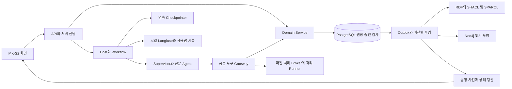

# MK-S2 구현의 아키텍처 기준

공식 v1.7의 업무·데이터·AI 아키텍처를 MK-S2 화면에 연결한다. 근거는 [자료 인덱스](SOURCE_INDEX.md)의 SRC-V17-01/02/03이다. 아래 내용은 새 기술 선택이 아니라 기존 결정을 구현 작업에 연결한 요약이다.

## 시스템 경계

도식은 책임 경계다. 별도 서버 수나 컨테이너 수를 뜻하지 않는다. LangGraph 실행 그래프·TBox/ABox 관계 그래프·Langfuse 실행 기록은 서로 다른 대상을 시각화한다.

## 구현에서 확인할 경계

| 구조 | 작업 | 반드시 확인할 결과 | 공식 근거 |
|---|---|---|---|
| FastAPI/Host·PostgreSQL | T01 | 실제 health·migration·DB 저장/재시작. UI 저장소로 대체 불가 | SRC-V17-03 §1~2, §12 T01 |
| 서버 신원·승인 | T02~03 | 세션·회사/행위 권한, 자기승인 금지, 정확 버전, 감사·멱등·outbox | SRC-V17-01 DEV-ID, RV, H / SRC-V17-03 §4 |
| 공통 SDK·도구 Gateway | T04 | typed 요청·결과, 근거·버전·공유 예산; Agent의 DB/비밀 직접 접근 차단 | SRC-V17-03 §2~3 |
| ModelGateway·관측 | T05 | LLMPort 뒤 provider 분리, canonical usage와 trace. Fake 호출도 실제 관측 경로로 검증 | SRC-V17-01 OBS17 / SRC-V17-03 §5.12, §8 |
| LangGraph·Supervisor | T06 | 기능 등록·분기·typed subgraph·진행 상태. 모든 요청이 LLM 분류를 거칠 필요 없음 | SRC-V17-01 LG17-01 / SRC-V17-03 §5.6~5.11 |
| 영속 Checkpointer·HITL | T07 | 재시작·승인 대기·재개 때 권한/버전 재검사. checkpoint와 원장은 분리 | SRC-V17-01 LG17-02 / SRC-V17-03 §5.9~5.10 |
| 제한 파일 처리 | T08 → T09 | 허용 파서·비밀/네트워크/자원 격리·취소. 실제 BOM은 이 경계 통과 후 처리 | SRC-V17-03 §6, §12 T08/T09 |
| 온톨로지 | T10 | OWL 의미, SHACL 제약, SPARQL 조회, Domain 계산의 역할 분리; RDF/Neo4j 같은 버전 | SRC-V17-03 §7 |
| 근거 검색 | T11 | 권한·회사·시점·버전 필터, exact/lexical/vector 및 필요한 관계 확장. 계산 사실은 업무 도구 사용 | SRC-V17-03 §7.3~7.4 |
| 전문 Agent | T12~14, T17~19 | Product/추출/매핑, Material, Substitute, Procurement, Knowledge, Quality 책임 유지 | SRC-V17-03 §5.7 |
| 실시간 상태 반영 | T03, T06, T10, T19 | commit 이후 사건 전달, 재연결·중복/역순 처리, 투영 ready 확인. 관련 대화만 변경 표시 | SRC-PLAN REALTIME_UPDATE_DESIGN |
| 평가와 규모 | T20~23 및 매 단계 | B0~B5, 독립 EX 실험, 실제 성능·규모를 측정 후 보고 | SRC-V17-03 §10~12 / SRC-AI |

## Agent와 Harness

Tool-Using·Workflow·Multi-Agent·Hierarchical·Harness-Based는 공통 구조로 유지한다. ReAct는 제한 적용, Plan-and-Execute는 업무별 적용이다. Reflection·Adaptive는 선택 기능·비교 실험이며 Swarm·Computer-Use를 서비스 기본 실행 경로로 강제하지 않는다. Coding은 개발 단계에서 사용한다. 근거: SRC-V17-03 §5.6.

Supervisor 아래 Product의 추출/매핑, Material Analysis, Substitute Review, Procurement Review, Knowledge, Quality 책임을 둔다. 한 질문에 모든 Agent를 실행하거나 역할마다 별도 모델·DB·서버를 만들 필요는 없다.

Outer Harness는 신원·입력·정책·예산·도구 실행 전 검사·출력·감사를 담당한다. Inner Harness는 필요한 계획·실행·결정적 검증·제한 수정/재시도를 담당한다. Critic은 Validator 실패나 승인 조건을 해제할 수 없다. Context에는 목표·시점·버전·근거 참조·미해결을 보존한다. 원문 근거를 요약으로 대체하지 않는다.

SDK는 공통 스키마의 제한적 상속·조합·버전 변환을 사용한다. Python 클래스 상속과 OWL 클래스 관계를 혼동하지 않는다. 개발 skills와 런타임 skills를 구분하며 MCP는 필요성이 확인된 adapter로만 추가한다.

## 구현 순서와 범위

공식 T00~T23을 유지하고 [작업표](IMPLEMENTATION_TASKS.md)의 slice별 완료를 기록한다. T04~T08 기반 없이 BOM·AI 화면부터 연결하는 우회를 피한다. T08은 T09의 실제 파일 처리 선행이다. 별도 기반 작업을 동시에 만들 수 있어도 통합 인수는 의존성을 만족해야 한다.

1차에 모든 v1.7 화면을 새로 추가하지 않는다. 공통 아키텍처는 처음부터 적용하고, 전체 고객 도착·추적·클레임·여러 모델·10만 객체 목표는 보존된 후속 Task로 구현한다.

## 공개 코드와 MK-S2 원본의 경계

MK-S2 원본은 비공개 기준 자료다. 공개 저장소에는 원본 HTML·내장 데이터·원문 파생 fixture를 그대로 복사하지 않는다. 공개할 프론트 코드의 원본 재사용·재배포 조건을 확인하고, 필요한 경우 비공개 기준을 보면서 승인된 화면 요소를 새 코드로 구성한다. 이 공개 경계 확인은 디자인 재설계가 아니라 자료 반입의 조건이다.
